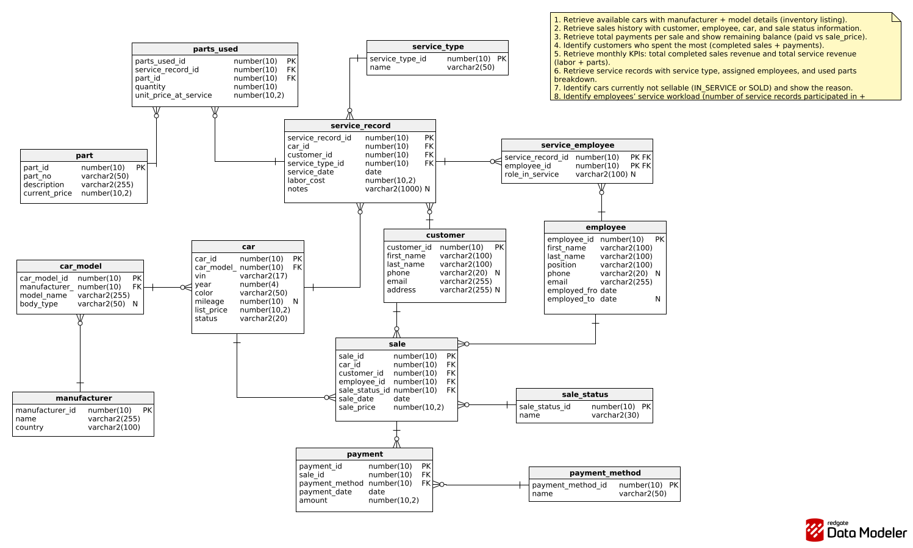

# Car Dealership Database Project (Oracle PL/SQL & SQL Server T-SQL)

A relational database for a car dealership, built twice: once for Oracle (PL/SQL) and once for Microsoft SQL Server (T-SQL). It covers the car inventory, customers, employees, sales with payments, and the service workshop (service records, assigned staff and parts used).

## Tech Stack
- Oracle: PL/SQL
- Microsoft SQL Server: T-SQL
- ER diagram: Redgate Data Modeler

## Schema (14 tables)
- **Inventory:** `manufacturer`, `car_model`, `car`
- **People:** `customer`, `employee`
- **Sales:** `sale`, `sale_status`, `payment`, `payment_method`
- **Service:** `service_record`, `service_type`, `service_employee`, `part`, `parts_used`

## Business Logic

| Object | Oracle | SQL Server | What it does |
| --- | --- | --- | --- |
| Procedure | `sp_finalize_sale` | `usp_FinalizeSale` | Completes a sale after checking that it has been fully paid |
| Procedure (cursor) | `sp_monthly_kpis` | `usp_MonthlyKpis` | Monthly KPIs: completed sales revenue and service revenue (labor + parts) |
| Trigger | `trg_sale_biud` | `trg_sale_aiu` | Sale rules and car status sync: a car that is SOLD or IN_SERVICE cannot be sold, an open sale reserves the car, a completed sale marks it SOLD, a cancelled or refunded sale makes it AVAILABLE again |
| Trigger | `trg_payment_compound` (compound) | `trg_payment_aiu` | Blocks payments above the sale price and marks the sale COMPLETED once it is fully paid |

## Files
- `01_ddl_oracle.sql` / `01_ddl_mssql.sql`: tables, keys and constraints
- `02_dml_oracle.sql` / `02_dml_mssql.sql`: seed data
- `03_proc_oracle.sql` / `03_proc_mssql.sql`: stored procedures
- `04_trg_oracle.sql` / `04_trg_mssql.sql`: triggers
- `database_requirements.txt`: project requirements
- `diagram.png`: ER diagram

## How to Run

### Oracle
Run in order:
1. `01_ddl_oracle.sql`
2. `02_dml_oracle.sql`
3. `03_proc_oracle.sql`
4. `04_trg_oracle.sql`

### SQL Server
Run in order:
1. `01_ddl_mssql.sql`
2. `02_dml_mssql.sql`
3. `03_proc_mssql.sql`
4. `04_trg_mssql.sql`

> `02_dml_mssql.sql` starts with `USE [2019SBD];`. Change it to the name of your own database before running.

## ER Diagram

